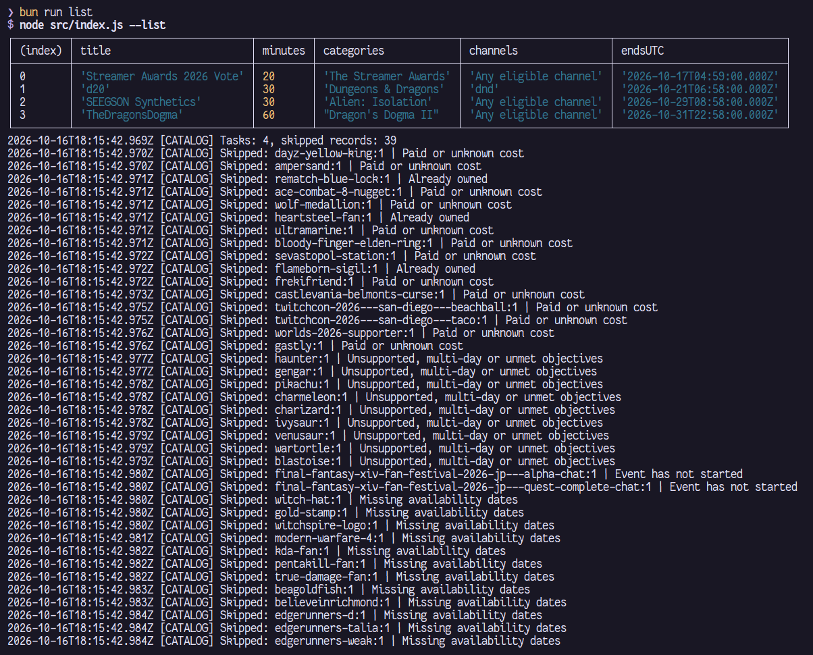
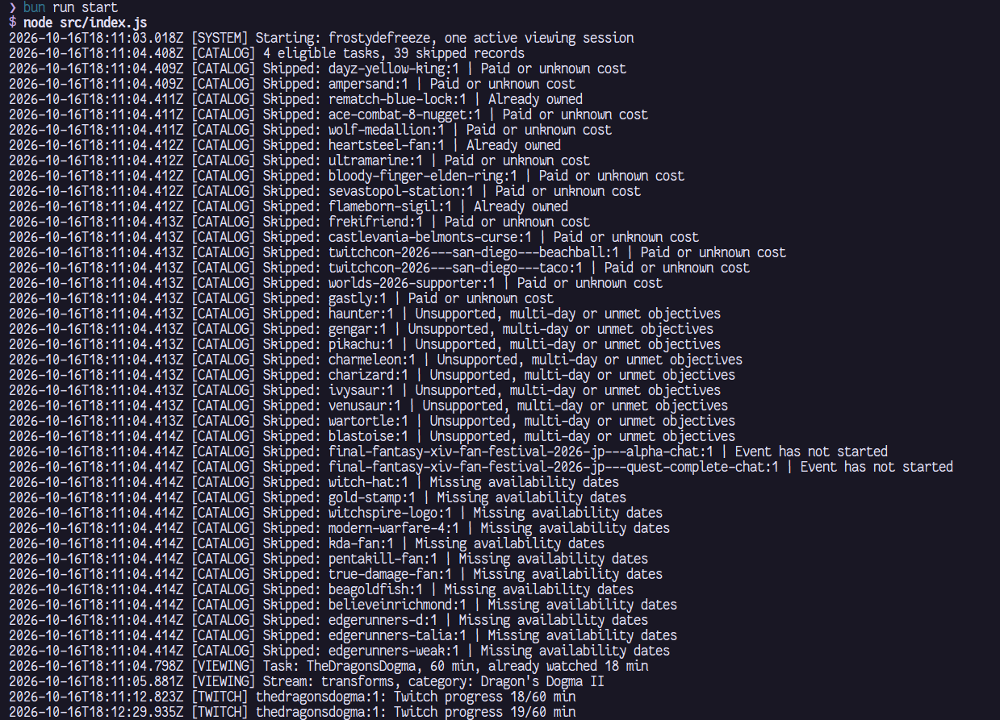

# Badge Farmer

[Русская версия](README.ru.md)

Collects free Twitch badges by watching eligible streams, one badge at a time

## Installation

Install [Node.js](https://nodejs.org/en/download) 22 or newer

Download the project from [GitHub](https://github.com/FrostyDeFreeze/twitch-badge-farmer) using **Code → Download ZIP**, extract it and open a terminal in the project folder

If you have Git installed, you can clone it instead

```sh
git clone https://github.com/FrostyDeFreeze/twitch-badge-farmer.git
cd twitch-badge-farmer
```

## Configuration

Choose either automatic setup or manual configuration

### Generate a token

Run this command from the project folder

```sh
npm run gen-token
```

1. Sign in to the Twitch account you want to use in the browser window that opens
2. Complete the authorization on Twitch; if prompted, enter the activation code shown in the terminal
3. Return to the terminal and wait for the `Config saved` message

If the browser does not open, use the activation link printed in the terminal

The command creates or updates `config.json` with your account details and token, using the Client ID already supplied in `config.example.json`
You do not need to fill in any fields yourself

### Manual configuration

Use a **Twitch TV-app OAuth token** obtained through device authorization with the Client ID from `config.example.json`
`npm run gen-token` creates this type of token automatically; for manual generation, follow this [device authorization example](https://github.com/rdavydov/Twitch-Channel-Points-Miner-v2/issues/94#issuecomment-1360683876)
Keep the `scopes` parameter empty to match `gen-token`

Once you have the TV-app token, copy `config.example.json` to `config.json` and fill in these fields

```json
{
	"id": "123456789",
	"login": "your_twitch_login",
	"client_id": "ue6666qo983tsx6so1t0vnawi233wa",
	"token": "your_oauth_token"
}
```

| Field       | What to enter            |
| ----------- | ------------------------ |
| `id`        | Your Twitch user ID      |
| `login`     | Your Twitch username     |
| `client_id` | TV Client ID             |
| `token`     | Your user OAuth TV token |

The account details and Client ID must match the token
You can find them through Twitch's [token validation endpoint](https://dev.twitch.tv/docs/authentication/validate-tokens/#how-to-validate-a-token): use `user_id` for `id`, and copy `login` and `client_id`

Keep `config.json` private, since it contains your access token

## Usage

Show the available badges without starting a viewing session

```sh
npm run list
```



Start farming

```sh
npm start
```



Leave the terminal open while farming
If there are no badges to collect, the tool keeps checking for new ones
Press **Ctrl+C** to stop; state is saved in `config.json.state.json` and reused on the next launch

Run only one instance per Twitch account and avoid watching other streams on that account while farming, as this can interfere with Drops progress

If you get an authorization error, run `npm run gen-token` again and sign in with the same Twitch account

## How It Works

1. Checks StreamDatabase for available free badges earned through viewing and skips badges you already own
2. Picks a badge, giving priority to rewards you have already started
3. Finds an eligible stream and watches it, trying another channel if viewing fails or progress stops
4. Tracks progress through Twitch, claims ready Drops and checks whether the badge has been added to your account
